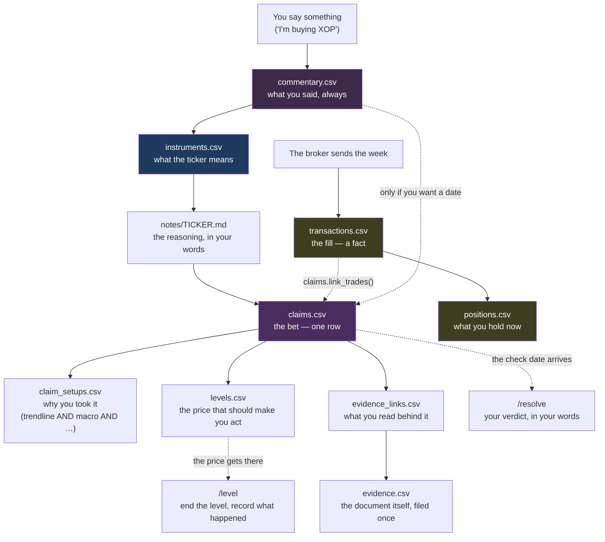
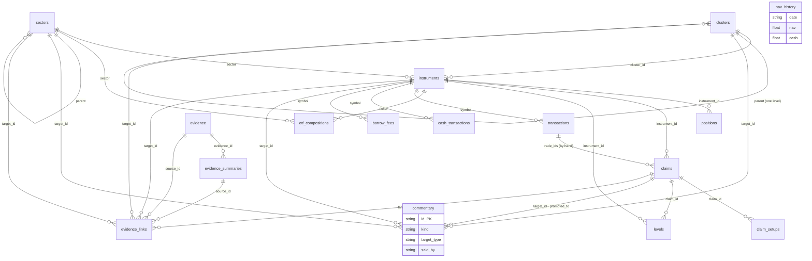

# The data model — what is stored where, and what holds it together

This is the map of the database. Read it when you want to know where a thing
you said ends up, or why a write was refused.

Two companions: [data-conventions.md](data-conventions.md) for how each file
merges and what the sector labels mean, and
[data-model-open-questions.md](data-model-open-questions.md) for where the shape runs out.

This is the *checkable* version: a `file:line` beside every rule so a session
can verify it rather than trust it. Those numbers go stale the moment the code
moves — a test re-checks them on every commit, so fix them, never believe them.

The headings below say who fills which. `instruments.csv` is the spine:
almost everything else points at it. Where the shape runs out is
[data-model-open-questions.md](data-model-open-questions.md).
---

## 1. How a decision becomes a record

This is the flow. Each box is a row in a table; the arrows are the order the
writes have to happen in, because each one refuses to be written before the
thing it points at exists.



Solid arrows are enforced **where the cell is filled in**. Two are conditional
rather than absolute: a claim may carry no note at all, and a level's
`claim_id` may be blank.

Dotted arrows are things **you** have to start. The end-of-turn note names
claims that have come due and levels the price has reached, but only you can
record a verdict.

**The one join that matters most is dotted.** `claims.trade_ids` is the only
link between plan and execution, filled in by hand after the fill — without it
`follow_through()` has nothing to measure.

---

## 2. The shape



`nav_history` stands alone — it is the only table with no link to anything
else. It is one row per day of account value.

---

## 3. The tables

⚠️ **No row counts here.** Ten of the sixteen written into this section were
wrong by 2026-09-29 — `claims.csv` said 33 against 59, `commentary.csv` said 0
against 14, `levels.csv` said "16 live, all soft" when seven were `hard` and six
were real orders at IBKR. For the numbers, run:

```bash
venv/bin/python ops/counts.py
```

That prints every table, the writing queue, and what is incomplete.

### The ones you fill in

| Table | Key | Holds |
|---|---|---|
| `instruments.csv` | `instrument_id` | **The spine.** What a ticker means — name, type, who runs it if it is a fund, your sector, your cluster, the note. Every other table points here |
| `claims.csv` | `id` (`c0001`…) | One row per bet. Append-only: `outcome`, `resolved_date`, `resolution_note`, `why_not`, `trade_ids`, `note_ref` and `decision` can be filled in later; everything else is frozen. **`decision`** groups the bets one call produced |
| `claim_setups.csv` | `claim_id` + `setup` | Why a bet was taken. Several reasons per bet is normal |
| `levels.csv` | `id` (`l0001`…) | A price, what currency it is in, and what to do at it. Append-only: never edited, `end_level()` then `add_level()`. `hard` means a real order at IBKR and requires `broker_verified` |
| `clusters.csv` | `cluster_id` | Your themes. A cluster may sit inside a group, one level deep |
| `sectors.csv` | `sector_id` | The sector labels and their parents |
| `commentary.csv` | `id` (`cm0001`…) | **Thoughts and commentary** — what you think, and what someone said. `kind` is `thought` (yours) or `commentary` (theirs). Can point at a holding, a theme, a sector, **the whole market**, or an earlier bet. ⚠️ **The one table a row may leave** |
| `evidence.csv` | `id` (`e0001`…) | One row per **document**. A report covering twelve stocks is one row. `author` and `gist` (added 2026-10-11, for newspaper pieces) are properties of the document like `published`, so one article linked to four things carries one gist, not four. Blank on everything filed before that date. `evidence.articles()` is the reading list |
| `evidence_summaries.csv` | `id` (`s0001`…) | One write-up per theme, each naming the document it came from |
| `evidence_links.csv` | target + source + `page` | The join: what a document is *about*, plus the page and a one-line why. ⚠️ **`macro` is the one target with no table behind it** — its id is fixed to `macro` (`evidence.MACRO_TARGET`) so synonyms cannot split the subject. The same idea is called **`market`** in `commentary.csv`; the two were left unmatched on 2026-10-11 by his explicit choice, so *"everything about macro"* must read **both words** |

⚠️ **`instruments.provider_sector` holds two incompatible vocabularies, and `provider_sector_as_of`
says which.** Dated rows hold a `data/sectors.csv` label (e.g. `Financials`) and are key-checked as
such; undated rows hold a raw vendor word that will never match it (e.g. `FINANCIAL SERVICES`).
Check the date before rolling a row up — `ops/data_gaps.py` does. `exposure.by_sector()` defaults to
this column (`classification="provider"`, spec D13), built for the portfolio page's by-sector panel —
so an undated row is not merely unkeyed, it is unused, and `exposure.sector_disagreements()` names
the holding rather than silently filing it under his own label.

⚠️ **`instruments.sector_settled` silences a check, permanently.** Blank and
`ops/data_gaps.py` compares `sector` against `provider_sector` every run;
dated, and he has decided his own label stands for good — not even a later
vendor reclassification reopens it. `set_sector_settled()` is the only
writer, and the schema refuses anything but a blank or a real date: the one
column whose job is silencing a check forever must not take a word.

### The ones the broker fills

| Table | Key | Holds |
|---|---|---|
| `positions.csv` | `ticker` | What you hold now. The only one that changes — prices update |
| `transactions.csv` | `trade_id` | Every fill. Append-only |
| `cash_transactions.csv` | `transaction_id` | Dividends, interest, fees. Append-only |
| `borrow_fees.csv` | `date` + `symbol` | Short-borrow charges. Append-only |
| `nav_history.csv` | `date` | Account value by day. Append-only |
| `corporate_actions.csv` | `transaction_id` | Splits, mergers, spin-offs. Append-only. **Added 2026-09-29** |
| `option_events.csv` | `trade_id` | Contract detail for an option or future leaving the book — strike, expiry, put/call, mark price. ⚠️ **OVERLAPS `transactions.csv`: never sum the P&L of both.** A row here usually shares a `trade_id` with a transaction and carries the SAME realized P&L, so adding the two double-counts; a cash settlement with no matching trade is the one case that is unique to this table. Append-only. Added 2026-09-29 |

When append-only is enforced and which table it cannot cover, what is written
but never read, and what IBKR sends that nothing parses are all sync
behaviour rather than shape —
[data-conventions.md](data-conventions.md#what-sync-writes-and-how).

### The ones a provider fills

Normally fetched, not typed from memory. They live in `data/market/` so it is
obvious at a glance which files hold your decisions and which hold a vendor's
answer. A hand-entered row must say so in `source_quality`: `issuer-by-hand`
when copied off the issuer's page, `estimate` when you worked the split out.

| Table | Key | Holds |
|---|---|---|
| `market/etf_compositions.csv` | `ticker` + `sector` | What each ETF is made of, how good the source is and when it was fetched. `top_holding` names the single company behind a slice where that is meaningful |
| `market/etf_holdings.csv` | `ticker` + `holding` | Which **companies** each ETF owns. `coverage` is how much of the fund the SOURCE accounted for, before cash lines and the small tail were dropped — the stored rows sum to less, and are never scaled up, so a floor stays visibly a floor. `as_of_kind` says whether the date is the issuer's or only the day we looked. `ops/refresh_etf_holdings.py` fills it |

### Not a table, but part of the record

- **`notes/`** — the reasoning that cannot be a cell. Layout, naming and the
  two headings the commit hook requires: [notes/README.md](../notes/README.md).
  `notes.status()` is the queue; it is never written down here.
- **`ops/vocab/`** — one text file per fixed-choice column. An unknown value is
  refused; add a line to the file to allow it.

## 4. Every link, and how it is enforced

There are four different ways a link is protected, and the difference matters:
**checked twice** means you cannot get it wrong; **at commit only** means the
write goes through and it blows up later, but it never reaches history; **on
write only** means it was true when written and nothing ever looks again, so it
can rot; **nothing** means it can be wrong forever and no one will tell you.

### Checked twice — on write *and* at commit

These are the safe ones. You cannot get them wrong by hand or by code.

| Link | On write | At commit |
|---|---|---|
| `claims.instrument_id` → `instruments` | `claims.py:465 check_known` | `pre-commit:199 instrument_id` |
| `claims.trade_ids` → `transactions.trade_id` | `claims.py:458 check_trade_ids` | `pre-commit:206 check_trade_ids` |
| `claim_setups.claim_id` → `claims` | `claims.py:529 claim_id` | `pre-commit:220 check_setup_claims` |
| `levels.instrument_id` → `instruments` | `levels.py:290 check_known` | `pre-commit:365 instrument_id` |
| `levels.claim_id` → `claims` | `levels.py:284 check_claim_id` | `pre-commit:370 check_claim_id` |
| `evidence_links.target_id` → claim/cluster/sector/instrument, or the fixed id `macro` | `evidence.py:360 check_target` | `pre-commit:302 check_links` |
| `evidence_links.source_id` → `evidence`/`evidence_summaries` | `evidence.py:378 check_source` | `pre-commit:302 check_links` |
| `evidence_summaries.evidence_id` → `evidence` | `evidence.py:194 evidence_id` | `pre-commit:258 check_summaries` |
| `clusters.parent` → `clusters` (+ 4 more tree rules) | `clusters.py:84 _check_tree`, on every read | same function |
| `etf_compositions.sector` → `sectors` | `ops/refresh_etf_compositions.py:309 check_known` | `pre-commit:172 check_known` |
| `commentary.target_id` → instrument/cluster/sector/claim | `commentary.py` `add()` | the commentary block in `pre-commit` |
| `commentary.promoted_to` → `claims.id` | `commentary.check_promoted_to()` | the same block |

### Checked only at commit — the write goes through, then fails later

You can write one of these and the code will accept it. It blows up when you
try to save, which may be an hour later.

| Link | Checked at | Nothing checks it on write because |
|---|---|---|
| `instruments.cluster_id` → `clusters` | `pre-commit:116 check_known` | `add_instrument()` takes a cluster without looking |
| `instruments.cluster_id` must not be a **group** | `instruments.set_cluster()` | `pre-commit:136-145 cluster_id` — a group holds no positions, so this would double-count |
| `instruments.sector` → `sectors` | `pre-commit:174 check_known` | same function, same gap |
| `instruments.provider_sector` → `sectors`, **only where `provider_sector_as_of` is filled** | `pre-commit:181 dated_provider_sectors` | `set_provider_sector()` must be able to date a row that still holds the raw vendor word. The date is what says which vocabulary the cell speaks |
| `etf_compositions.ticker` → `instruments` | `pre-commit:152 instruments` | the refresh script checks the *sector* before writing but not the ticker |
| `etf_holdings.ticker` → `instruments` | `pre-commit:166 check_known` | the refresh script validates the table's shape before writing but not the fund. ⚠️ `etf_holdings.holding` is deliberately **not** a key — those are the companies inside the fund, almost none of them held directly |
| `positions.instrument_id` → `instruments` | `pre-commit:375 instruments` | the sync writes it directly |
| `transactions`/`cash_transactions`/`borrow_fees` `.symbol` → `instruments` | `pre-commit:386 instruments` | the sync writes it directly |
| the six broker tables — rows may only be **added** | `pre-commit:382 check_broker_table` → `ibkr_sync.py:558 check_broker_table` | the sync never calls it, so a damaged file is written first and refused later |

### Checked only on write — never re-checked afterwards

A note file can be deleted, renamed or moved after the row that points at it
was written, and nothing at commit will notice.

| Link | Checked at | What catches it later |
|---|---|---|
| `claims.note_ref` → a real file | `claims.py:457 check_refs` | `claims.stale_refs()` — a report you have to run |
| `levels.note_ref` → a real file | `levels.py:283 check_refs` | `levels.stale_refs()` — a report you have to run |
| `clusters.note_ref` → a real file | `clusters.py:221 _check_note_ref`, `:303` | `notes.status()` shows it as a **broken link**, for an active cluster |
| `instruments.note_ref` → a real file | `instruments.py:424 _check_note_ref`, `:625` | `notes.status()` reads **missing** for a blank cell and **broken link** for a deleted file. `instruments.stale_refs()` covers the rows it skips |
| `evidence.location` → a real file when `storage=repo` | `evidence.py:450 check_location` | `evidence.stale_documents()` — a report |
| `commentary.note_ref` → a real file | `commentary.add()` via `claims.check_refs()` | nothing |
| `claims.nav_pct` → `positions.market_value` | `claims.py:469 position_pct_of_nav` | nothing — **it is frozen on purpose.** How big the bet was *then* is the fact worth keeping |
| `levels.instrument_id` → a lot you actually hold | `levels.py:291 check_held` | `levels.orphaned_levels()`. Only for `sell_all`, `trim_half` and `add`, and selling later does **not** invalidate the level — that case is surfaced as orphaned rather than tidied away |

The commit guard deliberately passes `require_file=False` when it re-checks
evidence locations (`pre-commit:251 check_locations`), so the file half of that check happens
exactly once, at write time.

### Checked by nothing, ever

| What | Why it matters | Live proof |
|---|---|---|
| `sectors.parent` is validated against a **text file** (`ops/vocab/sector_parent`), not against `sectors.csv` | a parent can be named without existing as a row — which had already happened | **found and fixed 2026-09-27**: three tops had no row, so research could not be filed against them. A test now guards the data; the design is unchanged |
| `clusters.status` against reality | a cluster can say `active` and hold nothing | ⚠️ Not automatically a defect. Real Estate holding nothing is **his decision, made twice** (REBUILD.md) — do not propose retiring it again. `clusters.weights()` shows which are empty |
| A note file with no row pointing at it | the note is invisible to `/show` and to `notes.status()` | how `_archive/notes/positions/` came to hold live theses for nine names he still owned. Emptied 2026-09-29; `notes/positions/` is now the only home |
| `claims.decision` → nothing at all | **a label, not a foreign key.** It groups the bets one call produced so `scoreboard()` can roll them up. Normalised on write (lowercase, hyphens) because a typo would split a call silently; `/note` offers the labels in use rather than letting you type one | `claims.decisions()` lists the labels in use — never type one |
| `claims.ticker` → anything at all | **deliberate.** `ticker` is what you typed at the time and is part of the record; `instrument_id` next to it is the link. The two are allowed to drift apart and nothing would say so | `ASML_USD` and `ASML_EUR` both carry `instrument_id=ASML` |
| `positions.csv` column types | **the table almost every module reads for every money number has no column schema at all** — only a foreign-key check | nothing would stop a blank `market_value`; `nav_pct` refuses at read time instead. It is also read ten different ways, each with its own NA handling |
| `etf_compositions` ticker + sector uniqueness | a duplicate row would **double-count that sector** in `by_sector()` | clean today (0 duplicates); `exposure.py:91 transform` checks that each ETF's weights sum to 1.0, but nothing anywhere checks the pair is unique |
| `positions.ticker` uniqueness | two rows for one lot would double-count the money | clean today; no schema exists to declare it |
| `commentary.csv` losing a row | **deliberate, and the reason this table exists.** A bet is history and `claims.csv` physically refuses to lose one; a comment is disposable. `forget()` is the sanctioned path and git keeps the previous version | the only table in the repo designed this way |
| **rows disappearing from most of the other tables** | `claim_setups.csv` and `evidence_links.csv` are the history behind *"which setups work for me"* and *"does reading Fundstrat help"* — a lost row silently changes both answers | only `claims`, `levels` and the six broker tables refuse to lose rows. The rest can, and nothing says so — unlike `commentary.csv`, where it is the point |

---

## 5. A decision, end to end

**[The XOP trade, start to finish](data-model-worked-example.md)** — with the
real ids: the watch, the fill, the hard stop at IBKR, the stop firing, and the
verdict.

---

## Reading this back

```bash
venv/bin/python ops/counts.py     # every table, the queue, what is incomplete
```

Three reports are watched by **no guard and no hook** — `orphaned_levels()`,
`stale_refs()` and `stale_documents()`. They tell you nothing unless you run
them, which is what `ops/counts.py` is for. `unchecked_levels()`,
`breached_levels()` and `due_claims()` are different: the end-of-turn note
reads all three, and names the levels rather than counting them.

`orphaned_levels()` is the sharpest: a level on something you no longer hold.
Only [`/level`](../.claude/skills/level/SKILL.md) reads it. Empty today.
